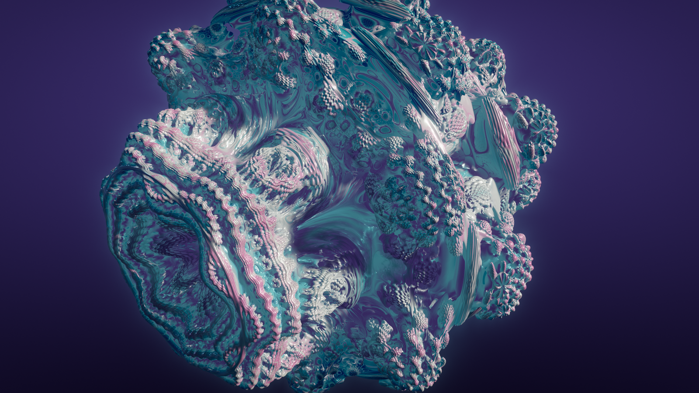
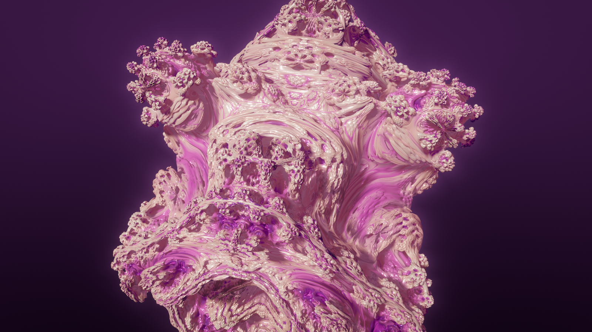
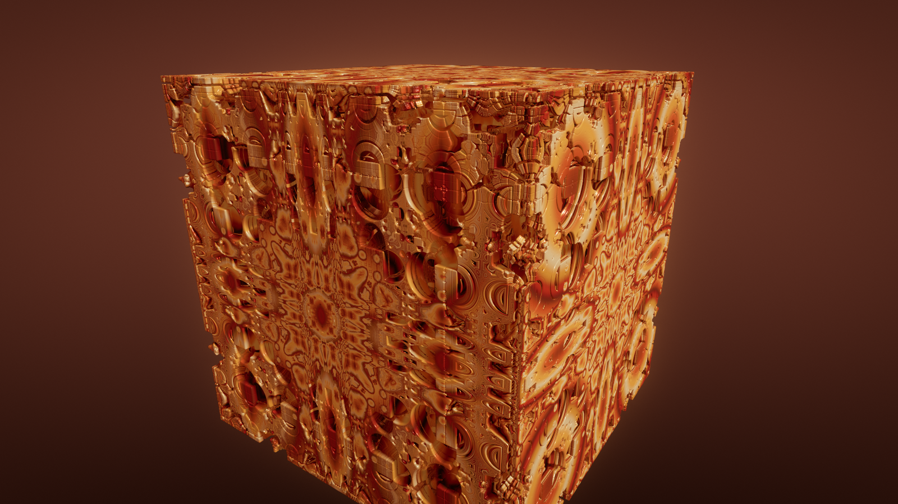
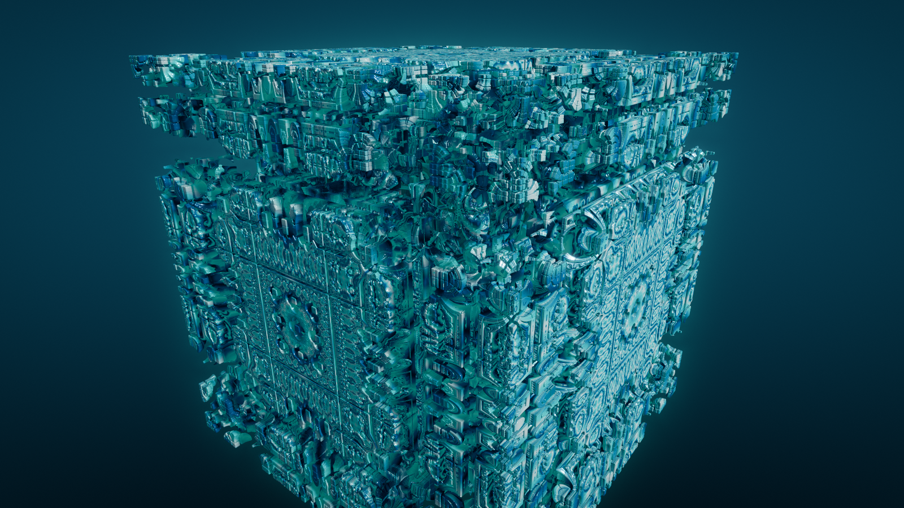
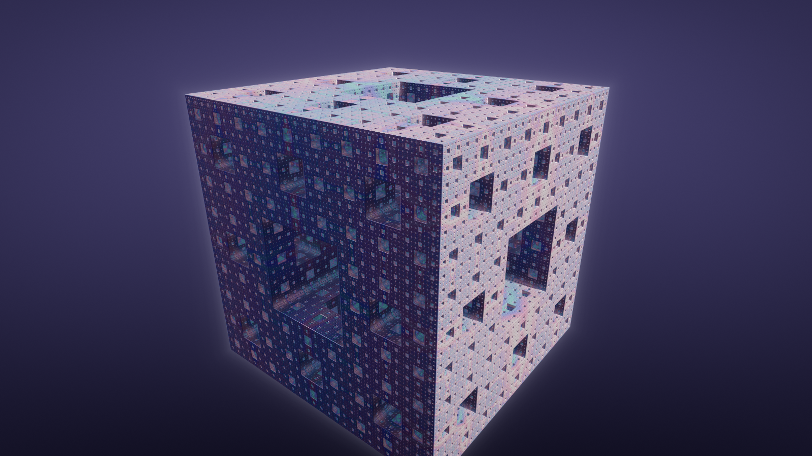
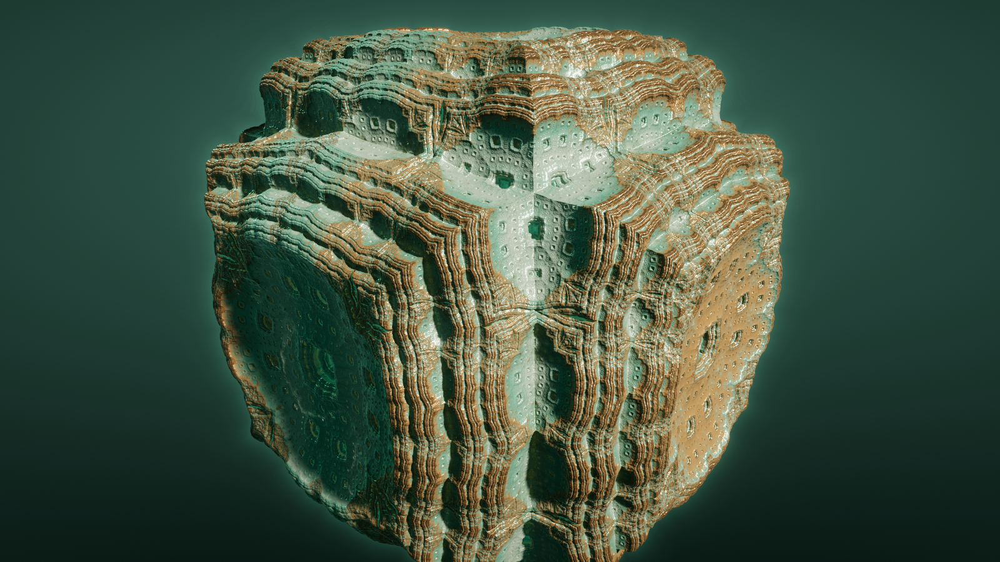
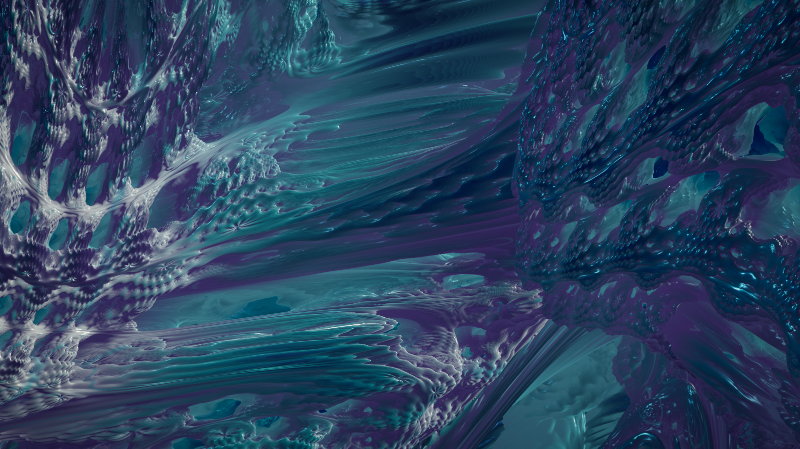
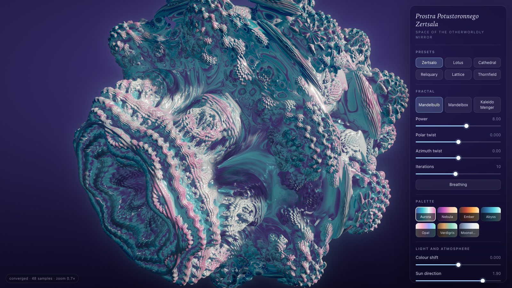

# Prostra Potustoronnego Zertsala

*Space of the Otherworldly Mirror*: a real-time 3D fractal explorer that runs in the browser.
Orbit, fly and dive into a Mandelbulb, a Mandelbox and a kaleidoscopic Menger sponge, ray
marched on the GPU with soft shadows, ambient occlusion, HDR bloom and filmic tone mapping.



| | |
|---|---|
|  |  |
|  |  |
|  |  |



Every image above was captured from the running app by `npm run capture`.

## Run it

Requires Node 20+ and a browser with WebGL2 (any current Chrome, Edge, Firefox or Safari).

```bash
npm install
npm run dev        # development server with hot reload
npm run build      # type-check and build to dist/
npm run preview    # serve the production build on http://localhost:4173
npm test           # unit tests for the distance estimators and the camera
npm run capture    # headless Chrome: screenshots into docs/screenshots/ plus smoke checks
```

`npm run capture` needs Google Chrome installed and a prior `npm run build`.

## Controls

| Input | Action |
|---|---|
| Drag | Orbit around the surface point under the cursor, with inertia |
| Scroll / pinch | Zoom toward the point under the cursor |
| Shift-drag or right-drag | Pan |
| `W` `A` `S` `D` `Q` `E` | Fly; speed follows the distance to the surface |
| `1` – `6` | Presets |
| `R` | Reset the current preset |
| `B` | Breathing (gentle parameter animation) |
| `P` | Save a PNG of the current image |
| `H` | Hide or show the interface |

The panel has the fractal picker, each fractal's parameters, seven palettes, light and
atmosphere sliders, and four quality presets. The pill at the bottom left shows frame rate
and resolution scale while moving, and accumulation progress once still.

## How it works

- **Distance estimators** with analytic running derivatives for all three fractals; see
  [docs/MATH.md](docs/MATH.md) for the formulas, why they are valid, and where they are
  only first-order.
- **Distance-adaptive hit threshold**: a ray stops when the estimated distance drops below
  the pixel's footprint at that depth, so the image is equally clean at any zoom.
- **Zoom-relative everything**: camera speed, fog, shadow and occlusion radii and the
  iteration count all scale with the view, so the controls and the look hold from the
  overview down to the float32 precision limit.
- **Lighting**: Cook–Torrance specular with Lambert diffuse, soft shadows, five-tap
  ambient occlusion, a rim light, a procedural sky used for reflections and fog, and a
  glow from rays that narrowly miss.
- **Orbit-trap colouring** through four-stop gradients; each palette brings its own sky
  and light colours.
- **Anti-aliasing by accumulation**: when nothing moves, jittered full-resolution frames
  are averaged (16 to 96 samples depending on quality), then rendering stops entirely.
- **Dynamic resolution**: while moving, GPU time is measured with a timer query and the
  render scale is adjusted to hold an 11 ms budget; frame intervals are the fallback.
- **Post-processing** in linear HDR: bloom, ACES filmic tone map, vignette, dither.

## Layout

```
src/main.ts               boot, frame loop, error overlay
src/app/                  fractal definitions, palettes, presets, state and quality tables
src/camera/               orbit / zoom / fly camera and input bindings
src/math/de.ts            CPU mirrors of the distance estimators (tests, picking)
src/render/               WebGL2 helpers, the renderer, and shaders/
src/ui/                   control panel and styles
tests/                    Vitest suites
scripts/capture.mjs       headless verification and screenshots
docs/MATH.md              the mathematics
```

## Performance

Measured on an Apple M1 Pro in Chrome (Metal), default "High" quality, while orbiting:

| Canvas | Frame rate | Resolution scale chosen |
|---|---|---|
| 1600 × 900 | 60 fps | 0.79 (Mandelbulb) |
| 2592 × 1500 (Retina window, DPR capped at 1.5) | 60 fps | 0.47 Mandelbulb, 0.44 Mandelbox, 0.94 Menger |

At the larger size a still image converges (48 samples) in about 1 to 3 seconds. The frame
loop allocates nothing: uniforms come from reused typed arrays and all render targets are
created only on resize.

## Decisions and assumptions

- **WebGL2 and plain TypeScript, no 3D engine.** The renderer is a handful of full-screen
  passes; a scene graph would add weight and nothing else. WebGL2 was chosen over WebGPU
  because it runs in every current browser and in headless Chrome for verification, and
  the image would be the same. The app has no runtime dependencies.
- **Vite and Vitest** for the build and tests; shaders are imported as raw text.
- **Third fractal: a kaleidoscopic Menger sponge**, because its estimator is a provable
  lower bound and its fold rotations give a very different family of shapes.
- **Mandelbox scale is limited to 1.6 – 3.2.** Between −1 and 1 the set degenerates, and
  a slider with a hole in it is worse than a clean positive range.
- **Sharpness while moving is traded for frame rate.** Moving frames are single-sample at
  a reduced scale with a shorter shadow march; the still image is always full quality.
  Breathing mode therefore shows the moving quality.
- **The camera stops at the float32 limit** (about 1,400× on the Mandelbulb) instead of
  letting the image dissolve into noise. Going deeper would need emulated double precision
  in the shader.
- **Iterations rise automatically with zoom**, on top of the slider value, capped at 24.
- **Desktop mouse or trackpad.** There is no touch gesture support; the layout does adapt
  to narrow windows.
- **`window.__pz`** is a small automation hook (load a preset, query convergence) used by
  the capture script. It holds no state of its own.
- **GitHub Pages**: `.github/workflows/deploy.yml` builds, tests and publishes `dist/` on
  every push to `main`. Pages must be enabled once in the repository settings with
  *Source: GitHub Actions*.

## Known limitations

- The Mandelbulb and Mandelbox estimators are first-order, not strict bounds; the tests
  quantify this and the marcher compensates with a step factor (details in MATH.md).
- Adding an iteration during a zoom makes fine detail appear in a visible step.
- Very thin features can lose their shadows at long range, where the shadow march takes
  larger minimum steps.
- No tiled high-resolution export: the PNG is the canvas at its current size.

## License

MIT, see [LICENSE](LICENSE).
